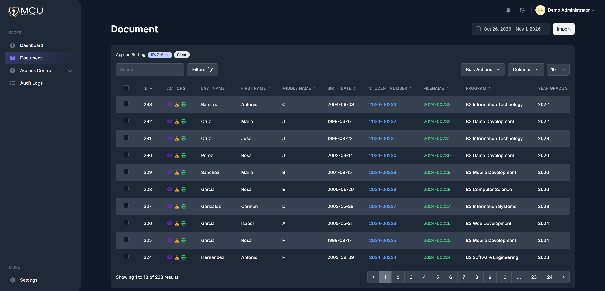

# DRMS Alumni Management System

DRMS is a web based alumni management system built with Laravel. It provides a central place for alumni and administrators to manage alumni records, profiles, and related information.

## Features

- Secure sign in and account management
- Alumni profile and records management
- Dashboard views for alumni information
- Administrative tools for maintaining the system
- Data import and export support

## Requirements

- PHP 8.3 or later
- Composer
- Node.js and npm
- A database supported by Laravel (for example, MySQL)

## Installation

1. Install PHP dependencies:

   ```sh
   composer install
   ```

2. Copy `.env.example` to `.env` and configure the application URL and database connection:

   ```sh
   cp .env.example .env
   ```

   On Windows PowerShell, use `Copy-Item .env.example .env` instead.

3. Generate the application key and create the database tables:

   ```sh
   php artisan key:generate
   php artisan migrate
   ```

4. Install frontend dependencies and compile the assets:

   ```sh
   npm install
   npm run build
   ```

5. Start the development server:

   ```sh
   php artisan serve
   ```

   Open the URL printed by Artisan, usually `http://127.0.0.1:8000`.

For frontend development with automatic asset rebuilding, run `npm run dev` in a separate terminal.

## Database seeders

To load the project's seed data, run:

```sh
php artisan db:seed
```

Review the seeders before running them against a database containing data, as seeders may add or modify records.

## Tech stack

- Laravel 10
- Livewire and Blade
- Tailwind CSS
- Vite
- MySQL (or another Laravel-supported database)
